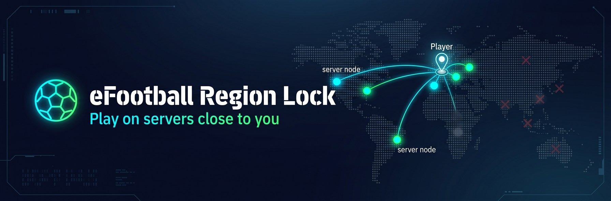

<p align="center"></p>

<p align="center"></p>

<h1 align="center">eFootball Region Lock</h1>

<p align="center">
  <b>Bloquea los servidores de partido de eFootball que están lejos de ti, para que tus partidos online se jueguen en los servidores más cercanos.</b><br>
  Funciona en cualquier país: mide tu propio ping y decide por ti.
</p>

<p align="center">
  
  
  
  
</p>

<p align="center">
  <a href="README.md">English</a> · <b>Español</b>
</p>

<p align="center">
  Powered by <a href="https://www.instagram.com/mrstalex/"><b>@mrstalex</b></a>
</p>

> [!NOTE]
> Herramienta de la comunidad, no oficial. Sin relación con Konami. Úsala bajo tu propia responsabilidad.

## Contenido

- [Por qué existe este proyecto](#por-qué-existe-este-proyecto)
- [El problema](#el-problema)
- [Cómo funciona](#cómo-funciona)
- [Tutorial paso a paso](#tutorial-paso-a-paso)
- [Qué esperar](#qué-esperar)
- [Herramientas de partido](#herramientas-de-partido)
- [¿Es seguro?](#es-seguro)
- [Qué nunca se bloquea](#qué-nunca-se-bloquea)
- [Línea de comandos](#línea-de-comandos)
- [Limitaciones conocidas](#limitaciones-conocidas)
- [Desinstalar](#desinstalar)
- [Preguntas frecuentes](#preguntas-frecuentes)

## Por qué existe este proyecto

Juego eFootball desde **Lima, Perú**. Sudamérica tiene pocas regiones de servidores, y los partidos a menudo terminaban jugándose lejos de casa.

Para entender qué pasaba, usé el Monitor de recursos de Windows y revisé a qué servidor se conectaba el juego en cada partido. Los resultados lo dejaron claro:

- Tres partidos se jugaron en **Santiago de Chile** (~55 ms). Dos fueron bien. Uno fue muy malo, y como el servidor era el mismo, el problema era la conexión del rival.
- Un partido se jugó en **Estados Unidos**, a **139 ms**. Con solo 2 barras de conexión, el partido era prácticamente injugable, mientras mi rival seguramente jugaba con una fracción de ese retraso.

Descubrí que los servidores de partido de eFootball funcionan en **Google Cloud y Amazon Web Services**, y que ambas empresas publican los rangos de IP oficiales de cada región. Primero bloqueé a mano los servidores lejanos en el Firewall de Windows y comprobé que el juego seguía funcionando con normalidad. Después lo convertí en esta herramienta, para que cualquier jugador, en cualquier país, pueda hacer lo mismo en un clic: mide **su propio** ping y decide qué servidores son cercanos para él.

— [@mrstalex](https://www.instagram.com/mrstalex/)

## El problema

eFootball elige un servidor de partido para ti y tu rival. A veces ese servidor está en otro continente. Tú juegas con 150 ms de retraso y tu rival con 10 ms, y el partido se siente pesado y lento.

Los servidores de partido de eFootball funcionan en **Google Cloud** y **Amazon Web Services**. Ambas empresas publican los rangos de IP oficiales de cada región, así que las regiones lejanas se pueden bloquear con precisión, sin adivinar.

## Cómo funciona

```text
1. Busca el juego          detecta Steam y la app de Xbox (Microsoft Store) automáticamente
2. Descarga las listas     listas oficiales de IP de Google y Amazon
3. Mide la latencia        a cada región de Google Cloud y AWS (unas 85, 5 muestras cada una, 2-3 minutos)
4. Mantiene las cercanas   p. ej. todo lo que esté por debajo de 100 ms, hasta 4 regiones
5. Bloquea el resto        Firewall de Windows, SOLO para eFootball, SOLO UDP de salida
```

Las reglas afectan **solo** a eFootball y **solo** a su tráfico de partido (UDP de salida). El login, los menús y la tienda siguen funcionando, y el resto de programas de tu PC (navegador, Discord, Zoom, Steam...) no se tocan.

Cómo se mide la latencia:

| Nube | Método |
|---|---|
| Google Cloud | Tiempo de conexión TCP al servidor regional oficial de Google, `storage.<región>.rep.googleapis.com` (o `compute.<región>...` donde no hay storage), que se atiende dentro de cada región |
| Amazon Web Services | Tiempo de conexión TCP al servidor oficial de cada región, `ec2.<región>.amazonaws.com` |

Cada región se mide **5 veces**. La herramienta usa la **mediana** como latencia estimada y muestra el **jitter** (cuánto varían las muestras) como nivel de estabilidad: Alta, Media o Baja.

Estos valores son una **estimación por región**: miden un punto de prueba dentro de cada región de la nube, no el servidor exacto de un partido futuro (la dirección del servidor cambia en cada partido). Los servidores de partido funcionan dentro de esas mismas regiones, así que la estimación es cercana: en las pruebas del autor, Santiago dio 31-34 ms con este método y 32-34 ms con un ping normal.

Para medir solo se contacta con servidores oficiales de Google y Amazon. Antes de usar las listas de IP, la herramienta comprueba que estén completas y que cada rango de IP esté bien formado. Si algo falla, no se cambia nada.

Listas oficiales de IP:
[Google Cloud](https://www.gstatic.com/ipranges/cloud.json) ·
[Amazon Web Services](https://ip-ranges.amazonaws.com/ip-ranges.json)

## Tutorial paso a paso

No necesitas saber programar. Tarda unos 3 minutos.

> [!WARNING]
> No apliques ni quites las reglas durante un partido. Cierra el juego o quédate en los menús.

### 1. Descargar

Entra en la **[última versión](https://github.com/Stalex07/efootball-region-lock/releases/latest)** y descarga el archivo `.zip` que aparece en **Assets**. Descomprímelo en cualquier carpeta (por ejemplo, el Escritorio).

Opcional: comprueba que el ZIP es el original. Abre PowerShell en tu carpeta de Descargas y ejecuta:

```powershell
Get-FileHash .\eFootball-Region-Lock-v1.3.2.zip -Algorithm SHA256
```

El resultado tiene que coincidir con el **SHA-256** que aparece en las notas de la versión.

### 2. Abrir el menú

Haz doble clic en **`Run.bat`**. Windows te pide permiso de administrador: pulsa **Sí**. Verás este menú:

```text
         _...----..._
       .'  \  __  /  '.      )  )  )
      /  ---\/  \/---  \
     |      |    |      |    eFootball Region Lock
      \  ---/\__/\---  /     Play on servers close to you
       '._ /      \ _.'
          '--....--'         Powered by @mrstalex
  ---------------------------------------------------------------

  SERVERS / SERVIDORES
  1. Simulate (measure only, change nothing)  / Simular
  2. Apply (max 100 ms, 4 servers)            / Aplicar
  3. Apply with custom settings               / Aplicar personalizado
  4. Choose regions by hand                   / Elegir regiones a mano

  DURING A MATCH / DURANTE UN PARTIDO
  5. Check current match server               / Revisar partido actual
  6. Live monitor (ping, jitter, loss)        / Monitor en vivo

  OTHER / OTROS
  7. Match history                            / Historial de partidos
  8. Status                                   / Estado
  9. Remove all rules                         / Quitar todo
  0. Exit                                     / Salir
```

> Si Windows muestra "Windows protegió su PC", es porque el archivo no tiene firma digital y se descargó de internet. Continúa (**Más información** → **Ejecutar de todas formas**) solo si lo descargaste desde la página de Releases de este repositorio, idealmente después de comprobar su SHA-256. También puedes abrir `eFootball-RegionLock.ps1` con el Bloc de notas y leer cada línea antes.

### 3. Primero simula (opción 1)

Pulsa **1**. La herramienta encuentra tu juego, mide la latencia a unas 85 regiones de servidores (2-3 minutos) y muestra una tabla con la latencia estimada, el jitter y la estabilidad de cada región, y lo que se **mantiene** o se **bloquearía**. **Todavía no cambia nada.**

Ejemplo para un jugador en Lima, Perú:

```text
Servidores de partido que se mantienen:
  Amazon  sa-west-1                                 38 ms
  Google  southamerica-west1       Santiago         40 ms
  Amazon  sa-east-1                Sao Paulo        81 ms
  Google  southamerica-east1       Sao Paulo        85 ms

Regiones a bloquear: 72  |  Rangos de IP: 3966
```

### 4. Aplicar (opción 2, 3 o 4)

- **2** mantiene las regiones con menos de **100 ms**, máximo **4**.
- **3** te pide los límites, por ejemplo **80** ms y **3** servidores. Solo acepta números enteros dentro del rango permitido.
- **4** te deja elegir las regiones tú mismo. La sugerencia automática viene marcada; escribe los números de las regiones que quieras activar o desactivar (por ejemplo `3 7 12`) y pulsa Enter cuando termines.

La herramienta vuelve a medir, muestra la tabla y pide confirmación. Escribe **S** y pulsa Enter. Cuando diga **Listo**, los servidores lejanos quedan bloqueados.

### 5. Jugar y comprobar

Juega unos partidos. Durante un partido puedes usar las [herramientas de partido](#herramientas-de-partido) (opciones **5** y **6**) para ver en qué servidor te tocó y qué tan buena es la conexión. La opción **8. Estado** te muestra las reglas activas en cualquier momento.

Si te salen errores de conexión o tarda mucho más de lo normal en emparejar, abre el menú y elige **9. Quitar todo**. Todo vuelve a la normalidad al instante.

## Qué esperar

> [!IMPORTANT]
> **Juega con conexión por cable (Ethernet).** Es la mejora más grande que puedes hacer: el Wi-Fi añade picos de retraso y pérdida de paquetes que ninguna herramienta puede arreglar.

**Lo que hace la herramienta:** todas las regiones de servidores de Google Cloud y Amazon que superan tu límite de latencia quedan bloqueadas para eFootball (salvo las pocas que aparecen en [Qué nunca se bloquea](#qué-nunca-se-bloquea)). Los partidos ya no se pueden jugar en esas regiones bloqueadas, aunque tu rival esté lejos.

**Lo que no puede controlar:** quién es tu rival, qué tan buena es su conexión, los partidos peer-to-peer y cualquier servidor que Konami use fuera de las regiones de las listas oficiales (ver [Limitaciones conocidas](#limitaciones-conocidas)).

**Por eso, si un partido sigue con lag o se desconecta** estando tú por cable, sin nadie en casa descargando o viendo streaming, y en un servidor cercano, **la causa más común es la conexión de tu rival** (Wi-Fi malo, descargas en su red, mala señal). Con menos frecuencia, puede ser un problema de ruta de tu proveedor de internet o un servidor saturado.

Revisa tu lado antes de culpar al rival:

- [ ] Conectado por cable Ethernet, no por Wi-Fi
- [ ] Sin descargas, actualizaciones ni streaming de video en tu red mientras juegas
- [ ] Navegador y launchers cerrados o sin actividad

## Herramientas de partido

Úsalas **mientras se juega un partido** (no en los menús). Sal del juego con Alt+Tab, elige la opción y vuelve.

| Opción | Qué muestra |
|---|---|
| **5. Revisar partido actual** | En qué servidor se juega el partido: nube (Google o Amazon), región y ciudad, más **ping, jitter, pérdida de paquetes** y una calificación de calidad. Si la dirección no está en las listas de Google ni de Amazon, te avisa de que el partido probablemente es **peer-to-peer** (directo con el otro jugador). |
| **6. Monitor en vivo** | Encuentra el servidor del partido y muestra una línea que se actualiza cada segundo con ping, mediana, jitter, pérdida y calidad. Pulsa cualquier tecla para parar. |
| **7. Historial de partidos** | Cada revisión y cada sesión del monitor se guardan en tu PC, para que con el tiempo veas qué servidores te dan mejores partidos. |

Ejemplo:

```text
  Partido actual
  ----------------------------------------
  Tipo       : Servidor de juego
  Nube       : Google Cloud
  Region     : southamerica-west1 (Santiago)
  Ping       : 33 ms   Jitter: 1 ms   Perdida: 0%
  Calidad    : Buena
```

Cómo encuentra el partido: le pregunta a Windows qué puertos de red tiene abiertos eFootball, y usa **pktmon**, el monitor de paquetes que viene con Windows, para mirar unos segundos de **cabeceras de paquetes** en esos puertos. El partido es la dirección con tráfico constante en ambos sentidos. Después busca esa dirección en las listas oficiales de Google y Amazon, y le hace un `ping` normal para medir la conexión.

El historial se guarda en `%LOCALAPPDATA%\eFootball Region Lock\match-history.csv`. Guarda la fecha, la región del servidor, el ping, el jitter, la pérdida y la calidad. **Nunca guarda la IP de tu rival.**

## ¿Es seguro?

**Nunca toca el juego.** Todas las opciones usan solo herramientas normales de Windows:

| Opción | Qué hace en realidad | ¿Toca el juego? |
|---|---|---|
| Simular / Aplicar / Elegir a mano | Mide la latencia a puntos públicos de la nube y añade reglas normales del **Firewall de Windows** | No |
| Revisar partido actual | Usa **pktmon** (viene con Windows) para leer una **copia** de las cabeceras de los paquetes: qué dirección habla con cuál. Nunca el contenido | No |
| Monitor en vivo | Hace un **ping** normal, igual que escribir `ping` en CMD | No |
| Historial de partidos | Escribe un archivo de texto (CSV) en tu PC | No |

**Lo que nunca hace:**

- Nunca abre, lee ni cambia los **archivos del juego**.
- Nunca lee ni escribe la **memoria** del juego (que es lo que buscan los sistemas anticheat).
- Nunca **inyecta** nada en el juego.
- Nunca **cambia, retrasa ni bloquea** paquetes del partido. Las herramientas de partido solo observan.
- Nunca envía tus datos a ningún sitio. El único tráfico de red es la descarga de las listas oficiales de IP, las mediciones de latencia y los pings.

**¿Me pueden banear?** Los sistemas anticheat buscan programas que se meten **dentro** del juego: leen su memoria, inyectan código o alteran lo que envía. Esta herramienta no hace nada de eso. Funciona como el Monitor de recursos o un `ping`. El riesgo es muy bajo, pero nadie puede prometer un 0%: Konami no publica qué revisa su anticheat, y sus términos ni permiten ni prohíben estas herramientas de forma explícita.

## Qué nunca se bloquea

| Qué | Por qué |
|---|---|
| Amazon `ap-northeast-1` (Tokio), `us-west-2` (Oregón), `eu-west-1` (Irlanda) | El juego se comunicó con estas regiones en todos los partidos de las pruebas del autor (login, emparejamiento, servicios del juego). Se dejan abiertas para que el juego siga funcionando. Konami podría cambiarlo en el futuro |
| Amazon Local Zones y direcciones Global Accelerator (`166.117.x.x`) | Son direcciones anycast/edge: no se puede medir dónde están de verdad |
| Servicios "global" de Google | No están en un país concreto |
| Cualquier región que no se haya podido medir | Por seguridad |
| Al menos las 2 regiones más cercanas | Para que siempre puedas encontrar partido, aunque vivas lejos de todos los servidores |

## Línea de comandos

Ejecútalos en PowerShell **como administrador**, dentro de la carpeta de la herramienta. `DryRun`, `Status` y `History` también funcionan sin permisos de administrador.

```powershell
# Simulación: mide y muestra, no cambia nada
.\eFootball-RegionLock.ps1 -Mode DryRun

# Aplicar: regiones con menos de 80 ms, máximo 3
.\eFootball-RegionLock.ps1 -MaxPing 80 -MaxServers 3

# Elegir las regiones a mano
.\eFootball-RegionLock.ps1 -Mode Pick

# Durante un partido: revisar el servidor o monitorearlo en vivo
.\eFootball-RegionLock.ps1 -Mode Match
.\eFootball-RegionLock.ps1 -Mode Monitor

# Partidos guardados
.\eFootball-RegionLock.ps1 -Mode History

# No bloquear nunca una región concreta
.\eFootball-RegionLock.ps1 -AlwaysAllow southamerica-east1

# Juego instalado en otra ruta
.\eFootball-RegionLock.ps1 -GamePath "D:\Juegos\eFootball\eFootball\Binaries\Win64\eFootball.exe"

# Ver o quitar las reglas
.\eFootball-RegionLock.ps1 -Mode Status
.\eFootball-RegionLock.ps1 -Mode Remove
```

| Parámetro | Por defecto | Qué hace |
|---|---|---|
| `-Mode` | `Apply` | `Apply`, `DryRun`, `Pick`, `Match`, `Monitor`, `History`, `Remove` o `Status` |
| `-MaxPing` | `100` | Latencia estimada máxima (ms) que puede tener una región para seguir permitida |
| `-MaxServers` | `4` | Mantener como máximo estas regiones. `0` = sin límite |
| `-MinServers` | `2` | Mantener siempre al menos estas regiones |
| `-AlwaysAllow` | ninguna | Códigos de región que nunca se bloquean |
| `-GamePath` | automático | Ruta(s) a `eFootball.exe` |
| `-Lang` | `auto` | Idioma: `auto`, `en` o `es` |
| `-AskSettings` | no | Pedir `-MaxPing` y `-MaxServers` en pantalla (solo números enteros) |
| `-CaptureSeconds` | `6` | Revisar / Monitor: segundos de cabeceras de tráfico a observar (3-30) |
| `-Yes` | no | No pedir confirmación |

## Limitaciones conocidas

- **La latencia es una estimación por región**, no el ping exacto de un partido. Un servidor de partido concreto puede ir unos ms más rápido o más lento que el punto de su región, así que deja algo de margen en `-MaxPing`.
- **Los partidos peer-to-peer no se controlan.** Algunos partidos (por ejemplo, los amistosos) pueden conectar a los jugadores directamente en vez de a través de un servidor en la nube.
- **Solo cubre servidores que estén en las listas oficiales de Google Cloud y AWS.** Si Konami usa otra infraestructura, no se bloquea.
- **No puede elegir ni arreglar a tu rival.** Si juega con mal Wi-Fi, el partido puede ir mal igual.
- **Puede tardar un poco más en encontrar partido**, porque se descartan rivales que necesitarían un servidor lejano. Si el juego no logra conectar, normalmente muestra un error antes de empezar y vuelve a buscar.
- **IPv6:** también se bloquean los rangos IPv6, pero todavía no se ha probado en una conexión real solo IPv6.
- **La versión de Microsoft Store / app de Xbox es experimental.** La herramienta busca el juego en las carpetas `XboxGames` y además crea una regla ligada al paquete de la Store. Se agradecen los comentarios.
- **Vuelve a ejecutarlo cada pocas semanas.** Google y Amazon agregan rangos de IP nuevos. Aplicar otra vez reemplaza las reglas anteriores.
- **Herramientas de partido:** necesitan Windows 10 versión 2004 o superior y permisos de administrador. Algunos servidores ignoran el ping, así que puede salir "sin respuesta". Las direcciones edge de Amazon (`166.117.x.x`) son anycast, así que no se puede mostrar su ciudad exacta. "Peer-to-peer" significa que la dirección no está en las listas de Google ni de Amazon: normalmente es el otro jugador, pero podría ser otro proveedor. Solo observan tráfico IPv4.
- Konami no explica cómo elige los servidores, y sus términos ni permiten ni prohíben reglas de firewall en tu propio PC.

## Desinstalar

Abre `Run.bat` → **9. Quitar todo**, o ejecuta como administrador:

```powershell
Remove-NetFirewallRule -Group "eFootball Region Lock"
```

Todas las reglas están en el grupo de firewall `eFootball Region Lock`. La opción del menú solo borra las reglas que llevan el nombre y la descripción propios de la herramienta, así que nunca toca reglas creadas por otra persona.

Para borrar también el historial de partidos, elimina la carpeta `%LOCALAPPDATA%\eFootball Region Lock`.

## Preguntas frecuentes

**¿Me pueden banear por esto?**
No toca los archivos del juego, ni su memoria, ni el contenido de su tráfico: solo usa el Firewall de Windows, pktmon y ping. El riesgo es muy bajo, pero los términos de Konami no mencionan estas herramientas de forma explícita. Mira [¿Es seguro?](#es-seguro) para más detalles.

**Igual me tocó un rival lejano.**
La herramienta no puede elegir a tu rival, solo qué servidores puede usar el partido. El juego puede emparejarte con alguien lejos y usar un servidor intermedio.

**¿Funciona con VPN?**
El ping se mide desde donde sale tu tráfico. Ejecútalo con la misma configuración de VPN con la que juegas.

## Licencia

[MIT](LICENSE)
