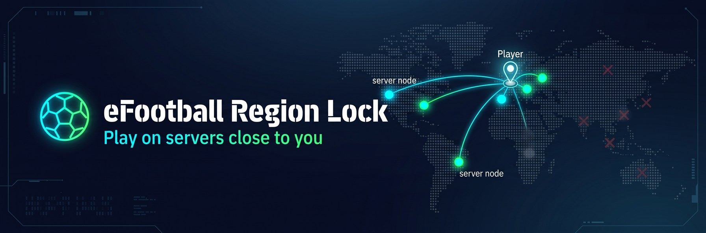

<p align="center"></p>

<p align="center"></p>

<h1 align="center">eFootball Region Lock</h1>

<p align="center">
  <b>Blocks far-away eFootball match servers, so your online matches are played on the servers closest to you.</b><br>
  Works anywhere in the world: it measures your own ping and decides for you.
</p>

<p align="center">
  
  
  
  
</p>

<p align="center">
  <b>English</b> · <a href="README.es.md">Español</a>
</p>

<p align="center">
  Powered by <a href="https://www.instagram.com/mrstalex/"><b>@mrstalex</b></a>
</p>

> [!NOTE]
> Unofficial community tool. Not affiliated with, endorsed by or supported by Konami. Use at your own risk.

## Contents

- [Why this project exists](#why-this-project-exists)
- [The problem](#the-problem)
- [How it works](#how-it-works)
- [Step-by-step tutorial](#step-by-step-tutorial)
- [What to expect](#what-to-expect)
- [Match tools](#match-tools)
- [Is it safe?](#is-it-safe)
- [What is never blocked](#what-is-never-blocked)
- [Command line](#command-line)
- [Known limitations](#known-limitations)
- [Uninstall](#uninstall)
- [FAQ](#faq)

## Why this project exists

I play eFootball from **Lima, Peru**. South America has only a few server regions, and my matches often ended up being played far from home.

To understand what was happening, I used Windows Resource Monitor to check which server the game connected to in every match. The results were clear:

- Three matches were played in **Santiago, Chile** (~55 ms). Two went well. One was terrible, and since the server was the same, the problem was my opponent's connection.
- One match was played in the **United States**, at **139 ms**. With only 2 connection bars it was practically unplayable, while my opponent was probably playing with a fraction of that delay.

I found out that eFootball's match servers run on **Google Cloud and Amazon Web Services**, and that both companies publish the official IP ranges of every region. First I blocked the far servers by hand in Windows Firewall and confirmed the game kept working normally. Then I turned it into this tool, so any player, in any country, can do the same in one click: it measures **their own** ping and decides which servers are close for them.

— [@mrstalex](https://www.instagram.com/mrstalex/)

## The problem

eFootball chooses one match server for you and your opponent. Sometimes that server is on another continent. You play with 150 ms of delay while your opponent plays with 10 ms, and the match feels heavy and unresponsive.

eFootball's match servers run on **Google Cloud** and **Amazon Web Services**. Both companies publish the official IP ranges of every region, so the far regions can be blocked precisely, without guessing.

## How it works

```text
1. Find the game         Steam and the Xbox app (Microsoft Store) are detected automatically
2. Download IP lists     official lists from Google and Amazon
3. Measure latency       to every Google Cloud and AWS region (about 85, 5 samples each, 2-3 minutes)
4. Keep the closest      e.g. everything under 100 ms, up to 4 regions
5. Block the rest        Windows Firewall, ONLY for eFootball, ONLY outbound UDP
```

The rules affect **only** eFootball and **only** its match traffic (outbound UDP). Login, menus and the store keep working, and every other program on your PC (browser, Discord, Zoom, Steam...) is untouched.

How latency is measured:

| Cloud | Method |
|---|---|
| Google Cloud | TCP connect time to Google's official regional endpoint `storage.<region>.rep.googleapis.com` (or `compute.<region>...` where storage is not available), which is served inside each region |
| Amazon Web Services | TCP connect time to the official regional endpoint `ec2.<region>.amazonaws.com` |

Each region is measured **5 times**. The tool uses the **median** as the estimated latency and shows the **jitter** (how much the samples vary) as a stability rating: High, Medium or Low.

These values are an **estimate per region**: they measure a test endpoint inside each cloud region, not the exact server of a future match (match server addresses change every match). Match servers run inside those same regions, so the estimate is close: in the author's tests, Santiago measured 31-34 ms with this method and 32-34 ms with a plain ping.

Only official Google and Amazon servers are contacted to measure. Before using the IP lists, the tool checks that they are complete and that every IP range is well formed. If a check fails, nothing is changed.

Official IP lists:
[Google Cloud](https://www.gstatic.com/ipranges/cloud.json) ·
[Amazon Web Services](https://ip-ranges.amazonaws.com/ip-ranges.json)

## Step-by-step tutorial

No programming needed. It takes about 3 minutes.

> [!WARNING]
> Do not apply or remove the rules during a match. Close the game or stay in its menus.

### 1. Download

Go to the **[latest release](https://github.com/Stalex07/efootball-region-lock/releases/latest)** and download the `.zip` file under **Assets**. Extract it to any folder (for example your Desktop).

Optional: check that the ZIP is the original. Open PowerShell in your Downloads folder and run:

```powershell
Get-FileHash .\eFootball-Region-Lock-v1.2.0.zip -Algorithm SHA256
```

The result must match the **SHA-256** shown in the release notes.

### 2. Open the menu

Double-click **`Run.bat`**. Windows asks for administrator permission: click **Yes**. You will see this menu:

```text
         _...----..._
       .'  \  __  /  '.      )  )  )
      /  ---\/  \/---  \
     |      |    |      |    eFootball Region Lock
      \  ---/\__/\---  /     Play on servers close to you
       '._ /      \ _.'
          '--....--'         Powered by @mrstalex
  ---------------------------------------------------------------

  SERVERS / SERVIDORES
  1. Simulate (measure only, change nothing)  / Simular
  2. Apply (max 100 ms, 4 servers)            / Aplicar
  3. Apply with custom settings               / Aplicar personalizado
  4. Choose regions by hand                   / Elegir regiones a mano

  DURING A MATCH / DURANTE UN PARTIDO
  5. Check current match server               / Revisar partido actual
  6. Live monitor (ping, jitter, loss)        / Monitor en vivo

  OTHER / OTROS
  7. Match history                            / Historial de partidos
  8. Status                                   / Estado
  9. Remove all rules                         / Quitar todo
  0. Exit                                     / Salir
```

> If Windows shows "Windows protected your PC", it is because the file is not digitally signed and was downloaded from the internet. Only continue (**More info** → **Run anyway**) if you downloaded it from this repository's Releases page, ideally after checking its SHA-256. You can also open `eFootball-RegionLock.ps1` with Notepad and read every line first.

### 3. Simulate first (option 1)

Press **1**. The tool finds your game, measures the latency to about 85 server regions (2-3 minutes) and shows a table with the estimated latency, jitter and stability of each region, and what would be **kept** or **blocked**. **Nothing is changed yet.**

Example for a player in Lima, Peru:

```text
Match servers you will keep:
  Amazon  sa-west-1                                 38 ms
  Google  southamerica-west1       Santiago         40 ms
  Amazon  sa-east-1                Sao Paulo        81 ms
  Google  southamerica-east1       Sao Paulo        85 ms

Regions to block: 72  |  IP ranges: 3966
```

### 4. Apply (option 2, 3 or 4)

- **2** keeps the regions under **100 ms**, at most **4**.
- **3** asks you for the limits, for example **80** ms and **3** servers. Only whole numbers in the allowed range are accepted.
- **4** lets you choose the regions yourself. The automatic suggestion comes pre-selected; type the numbers of the regions you want to switch on or off (for example `3 7 12`) and press Enter when you are done.

The tool measures again, shows the table and asks for confirmation. Type **Y** (or **S**) and press Enter. When it says **Done**, the far servers are blocked.

### 5. Play and check

Play a few matches. During a match you can use the [match tools](#match-tools) (options **5** and **6**) to see which server you got and how good the connection is. Option **8. Status** shows the active rules at any time.

If you get connection errors or matchmaking takes much longer than usual, open the menu and choose **9. Remove all rules**. Everything goes back to normal immediately.

## What to expect

> [!IMPORTANT]
> **Play on a wired (Ethernet) connection.** It is the single biggest improvement you can make: Wi-Fi adds delay spikes and packet loss that no tool can fix.

**What the tool does:** every Google Cloud and Amazon server region above your latency limit is blocked for eFootball (except the few listed in [What is never blocked](#what-is-never-blocked)). Matches can no longer be played on those blocked regions, even when your opponent is far away.

**What it cannot control:** who your opponent is, how good their connection is, peer-to-peer matches, and any server Konami runs outside the regions in the official lists (see [Known limitations](#known-limitations)).

**So if a match still lags or disconnects** while you are on cable, nobody at home is downloading or streaming, and the match is on a nearby server, **the most common cause is your opponent's connection** (bad Wi-Fi, downloads on their network, weak signal). Less often it can be a route problem at your internet provider or a busy server.

Quick check of your side before blaming the opponent:

- [ ] Connected by Ethernet cable, not Wi-Fi
- [ ] No downloads, updates or video streaming on your network while playing
- [ ] Browser and launchers closed or idle

## Match tools

Use these **while a match is being played** (not in the menus). Alt+Tab out of the game, pick the option, then go back.

| Option | What it shows |
|---|---|
| **5. Check current match server** | Which server the match is using: cloud (Google or Amazon), region and city, plus **ping, jitter, packet loss** and a quality rating. If the address is not in the Google or Amazon lists, it tells you the match is probably **peer-to-peer** (directly with the other player). |
| **6. Live monitor** | Finds the match server, then shows one line that updates every second with ping, median, jitter, loss and quality. Press any key to stop. |
| **7. Match history** | Every check and monitor session is saved on your PC, so over time you can see which servers give you the best matches. |

Example:

```text
  Current match
  ----------------------------------------
  Type       : Game server
  Cloud      : Google Cloud
  Region     : southamerica-west1 (Santiago)
  Ping       : 33 ms   Jitter: 1 ms   Loss: 0%
  Quality    : Good
```

How it finds the match: it asks Windows which network ports eFootball has open, then uses **pktmon**, the packet monitor built into Windows, to look at a few seconds of **packet headers** on those ports. The match is the address with steady two-way traffic. The address is then looked up in the official Google and Amazon lists, and pinged with a normal `ping` to measure the connection.

The history is saved in `%LOCALAPPDATA%\eFootball Region Lock\match-history.csv`. It stores the date, server region, ping, jitter, loss and quality. **It never saves your opponent's IP address.**

## Is it safe?

**It never touches the game.** Every option only uses standard Windows tools:

| Option | What it really does | Touches the game? |
|---|---|---|
| Simulate / Apply / Choose by hand | Measures latency to public cloud endpoints and adds standard **Windows Firewall** rules | No |
| Check current match | Uses **pktmon** (built into Windows) to read a **copy** of packet headers: which address talks to which. Never the content | No |
| Live monitor | Sends a normal **ping**, the same as typing `ping` in CMD | No |
| Match history | Writes a text file (CSV) on your PC | No |

**What it never does:**

- Never opens, reads or changes the **game files**.
- Never reads or writes the game's **memory** (what anti-cheat systems look for).
- Never **injects** anything into the game.
- Never **changes, delays or drops** match packets. The match tools only observe.
- Never sends your data anywhere. The only network traffic is downloading the official IP lists, the latency probes and the pings.

**Can it get you banned?** Anti-cheat systems look for programs that get **inside** the game: reading its memory, injecting code or altering what it sends. This tool does none of that. It works like Resource Monitor or a `ping`. The risk is very low, but nobody can promise 0%: Konami does not publish what its anti-cheat checks, and its terms neither allow nor forbid these tools explicitly.

## What is never blocked

| What | Why |
|---|---|
| Amazon `ap-northeast-1` (Tokyo), `us-west-2` (Oregon), `eu-west-1` (Ireland) | The game kept talking to these regions in every match of the author's tests (login, matchmaking, game services). They stay open so the game keeps working. Konami may change this in the future |
| Amazon Local Zones and Global Accelerator addresses (`166.117.x.x`) | Anycast/edge addresses: their real location cannot be measured |
| Google `global` services | Not tied to a country |
| Any region the tool could not measure | Safety first |
| At least the 2 closest regions | So you can always find matches, even far from every server |

## Command line

Run these from an **administrator** PowerShell in the tool's folder. `DryRun`, `Status` and `History` also work without admin rights.

```powershell
# Simulation: measure and show, change nothing
.\eFootball-RegionLock.ps1 -Mode DryRun

# Apply: regions under 80 ms, at most 3
.\eFootball-RegionLock.ps1 -MaxPing 80 -MaxServers 3

# Choose the regions by hand
.\eFootball-RegionLock.ps1 -Mode Pick

# During a match: check the server, or monitor it live
.\eFootball-RegionLock.ps1 -Mode Match
.\eFootball-RegionLock.ps1 -Mode Monitor

# Saved matches
.\eFootball-RegionLock.ps1 -Mode History

# Never block a specific region
.\eFootball-RegionLock.ps1 -AlwaysAllow southamerica-east1

# Game installed somewhere unusual
.\eFootball-RegionLock.ps1 -GamePath "D:\Games\eFootball\eFootball\Binaries\Win64\eFootball.exe"

# Show or remove the rules
.\eFootball-RegionLock.ps1 -Mode Status
.\eFootball-RegionLock.ps1 -Mode Remove
```

| Parameter | Default | Meaning |
|---|---|---|
| `-Mode` | `Apply` | `Apply`, `DryRun`, `Pick`, `Match`, `Monitor`, `History`, `Remove` or `Status` |
| `-MaxPing` | `100` | Highest estimated latency (ms) a region may have to stay allowed |
| `-MaxServers` | `4` | Keep at most this many regions. `0` = no limit |
| `-MinServers` | `2` | Always keep at least this many regions |
| `-AlwaysAllow` | none | Region codes that must never be blocked |
| `-GamePath` | auto | Path(s) to `eFootball.exe` |
| `-Lang` | `auto` | Output language: `auto`, `en` or `es` |
| `-AskSettings` | off | Ask for `-MaxPing` and `-MaxServers` on screen (whole numbers only) |
| `-CaptureSeconds` | `6` | Match / Monitor: seconds of traffic headers to look at (3-30) |
| `-Yes` | off | Skip the confirmation prompt |

## Known limitations

- **Latency is an estimate per region**, not the exact ping of a match. A specific match server can be a few ms faster or slower than its region's endpoint, so leave some margin in `-MaxPing`.
- **Peer-to-peer matches are not controlled.** Some matches (for example friend matches) can connect players directly instead of through a cloud server.
- **Only servers inside the official Google Cloud and AWS lists are covered.** If Konami uses other infrastructure, it is not blocked.
- **It cannot choose or fix your opponent.** If they play on bad Wi-Fi, the match can still feel bad.
- **Matchmaking may take a little longer**, because opponents who would need a far server are filtered out. When the game cannot connect, it normally shows a connection error before kick-off and searches again.
- **IPv6:** IPv6 ranges are blocked too, but the tool has not yet been tested on a real IPv6-only connection.
- **Microsoft Store / Xbox app version is experimental.** The tool looks for the game in the `XboxGames` folders and also adds a rule bound to the Store package. Feedback is welcome.
- **Re-run it every few weeks.** Google and Amazon add new IP ranges over time. Applying again replaces the previous rules.
- **Match tools:** they need Windows 10 version 2004 or newer and administrator rights. Some servers ignore ping, so the card can show "no reply". Amazon edge addresses (`166.117.x.x`) are anycast, so their exact city cannot be shown. "Peer-to-peer" means the address is not in the Google or Amazon lists: usually the other player, but it could also be another provider. The tools look at IPv4 traffic only.
- Konami does not document how server selection works, and its terms neither allow nor forbid firewall rules on your own PC.

## Uninstall

Open `Run.bat` → **9. Remove all rules**, or run as administrator:

```powershell
Remove-NetFirewallRule -Group "eFootball Region Lock"
```

Every rule belongs to the firewall group `eFootball Region Lock`. The menu option only removes rules that carry the tool's own name and description, so rules created by anyone else are never touched.

To also delete the match history, remove the folder `%LOCALAPPDATA%\eFootball Region Lock`.

## FAQ

**Will this get me banned?**
It does not touch the game files, memory or traffic contents: it only uses Windows Firewall, pktmon and ping. The risk is very low, but Konami's terms do not mention these tools explicitly. See [Is it safe?](#is-it-safe) for the details.

**I still got a far opponent.**
The tool cannot choose your opponent, only which servers the match can use. The game may still pair you with someone far away and use a server in between.

**Does it work with a VPN?**
The ping is measured from wherever your traffic exits. Run it with the same VPN setup you play with.

## License

[MIT](LICENSE)
